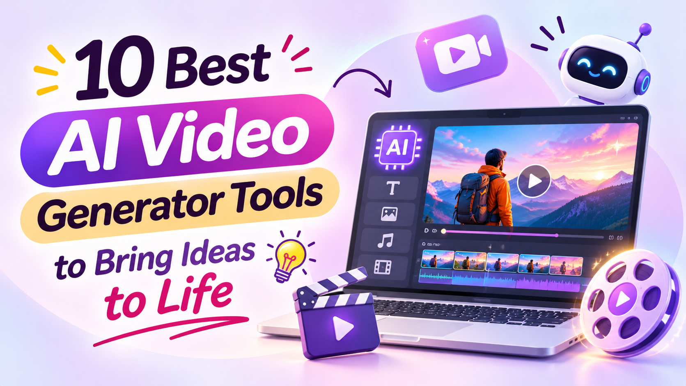

# 10 Best AI Video Generator Tools to Bring Ideas to Life

Creating professional videos has become easier with the help of artificial intelligence. AI video generator tools allow users to turn simple text prompts, images, and creative ideas into engaging videos without requiring advanced editing skills or expensive equipment.

Modern AI tools offer features such as text-to-video, image-to-video, AI avatars, voiceovers, and realistic animations. Whether you are a beginner, YouTuber, content creator, or business owner, these platforms can help you save time and create engaging content. You can also explore [**useful online tools and resources**](https://www.yttags.com/) for your digital projects.

In this GithubRepo. , we will explore the 10 best AI video generator tools in 2027, comparing their features, services, pricing, advantages, and disadvantages. You will also learn how to choose the right platform for your video creation needs.

## **Understanding AI Video Generator Tools**

AI video generator tools are software platforms that use artificial intelligence to create videos from text prompts, images, or existing media. They help users produce videos without needing professional cameras, editing experience, or advanced technical knowledge.

These tools use AI models to generate scenes, animations, characters, voiceovers, and visual effects. Some platforms can even turn a simple written idea into a complete video within minutes. Users can also combine AI-generated images with video technology to create more engaging content. If you want to explore image creation options, check out these [best AI image generators](https://www.yttags.com/best-ai-image-generators).

### **What Can AI Video Generator Tools Do ?**

- **Text-to-Video:** Convert written prompts into video clips.
- **Image-to-Video:** Animate static images into moving scenes.
- **AI Avatars:** Create virtual presenters for tutorials and business videos.
- **Voiceovers:** Generate realistic AI narration in different voices.
- **Video Editing:** Improve clips with transitions, effects, and automatic editing.
- **Marketing Videos:** Create promotional videos for products, services, and social media.

### **Why Are AI Video Generators Becoming Popular ?**

AI video generators are becoming popular because they reduce production time and make video creation more accessible. Small businesses can create promotional content, YouTubers can produce engaging clips, and marketers can develop video campaigns without hiring large production teams.

However, every platform offers different features, video quality, pricing, and usage limits. Therefore, choosing the right tool depends on your content goals, budget, and editing requirements.

## **Quick Recommendation:**

- **Best Overall:** Runway AI
- **Best for Realistic Videos:** Kling AI
- **Best for AI Avatars:** HeyGen
- **Best for Beginners:** Canva AI Video
- **Best for Marketing Videos:** Synthesia
- **Best for Creative Effects:** Pika AI

## **Quick Comparison: Best AI Video Generator Tools**

Choosing the right AI video generator can be difficult because every platform offers different features, pricing, and video quality. Some tools are better for realistic videos, while others focus on AI avatars, social media content, or professional editing.

Here is a quick comparison of the 10 best AI video generator tools in 2027 to help you find the right option.

| AI Video Tool  | Best For                       | Main Features                                  | Free Option          | Starting Price     |
| -------------- | ------------------------------ | ---------------------------------------------- | -------------------- | ------------------ |
| Runway AI      | Professional video creation    | Text-to-video, image-to-video, editing         | Limited credits      | $15/month          |
| Kling AI       | Realistic AI videos            | Motion generation, image animation             | Limited free credits | Around $10/month   |
| Google Veo     | High-quality video generation  | Realistic scenes, AI audio                     | Limited access       | From $4.99/month   |
| Adobe Firefly  | Creative and commercial videos | Text-to-video, image-to-video                  | Limited free credits | Around $9.99/month |
| Pika AI        | Social media videos            | AI effects, animation, video editing           | Limited access       | Around $10/month   |
| Synthesia      | AI avatar videos               | AI presenters, voiceovers, multilingual videos | Free limited plan    | Around $19/month   |
| HeyGen         | Marketing and business videos  | AI avatars, translation, voice cloning         | Free limited plan    | Around $29/month   |
| InVideo AI     | Text-to-video creation         | Script generation, voiceovers, templates       | Limited free plan    | Around $20/month   |
| Luma AI        | Cinematic AI videos            | Text-to-video, image animation                 | Limited access       | Around $30/month   |
| Canva AI Video | Beginners and social media     | AI video clips, templates, editing             | Limited AI features  | Canva plan varies  |

Prices are approximate USD starting prices based on available November 2027 information. Actual prices, credits, free limits, and regional availability may vary. Check the official pricing page before purchasing.

## 1. Runway AI – Best for Professional AI Video Creation

**Best For:** Professional video creators, filmmakers, marketers, and editors who want high-quality AI-generated videos.

### Overview

Runway AI is an advanced AI-powered video creation platform that helps users turn text prompts and images into engaging video clips. It offers video generation, editing, and creative tools for different production needs. Users can create cinematic scenes, animate images, and experiment with different visual styles. You can also explore these [**best AI image generation tools**](https://www.yttags.com/best-ai-image-generation-tools/) to create visual assets for your videos.

### Key Features

- Text-to-video generation.
- Image-to-video conversion.
- AI-powered video editing.
- Realistic motion and scene generation.
- Video background and visual effects.
- Multiple creative AI models.

### Services

- AI video generation from text prompts.
- Image animation and video creation.
- AI-powered video editing.
- Creative video production.
- Marketing and promotional video creation.
- Video enhancement and modification.

### Advantages and Disadvantages

| Advantages | Disadvantages |
|---|---|
| High-quality video generation | Advanced plans can be expensive |
| Supports text and image inputs | Limited credits on lower plans |
| Offers creative editing features | Beginners may need practice |
| Suitable for professional projects | Results may require multiple attempts |
| Multiple AI tools in one platform | Some features have usage restrictions |

### Pricing

Runway offers free and paid plans for different video creation needs.

- **Free Plan:** $0/month – Includes 125 one-time credits.
- **Standard Plan:** $15/month or $12/month with annual billing – Includes 625 monthly credits.
- **Pro Plan:** $35/month or $28/month with annual billing – Includes 2,250 monthly credits.
- **Max Plan:** $95/month or $76/month with annual billing – Includes 9,500 monthly credits.

### Review

Runway AI is a useful choice for creators who want professional-looking AI videos without a complicated production process. Its generation and editing capabilities make it suitable for creative projects, marketing content, and filmmaking experiments. However, users should consider credit limits and subscription costs before selecting a plan.

## 2. Kling AI – Best for Realistic AI-Generated Videos

**Best For:** Content creators, filmmakers, and marketers who want realistic AI-generated videos with natural movements.

### Overview

Kling AI is an AI video generation platform that creates videos from text prompts and images. It is known for realistic movements, detailed scenes, and cinematic video generation. Users can animate static images, create short video clips, and experiment with different visual styles. It is especially useful for creators who want lifelike characters and objects in their videos. You can also explore these [**AI video character generator tools**](https://www.yttags.com/best-ai-video-character-generators/) for more character-based video creation options.

### Key Features

- Text-to-video generation.
- Image-to-video animation.
- Realistic character movements.
- AI-powered motion generation.
- Cinematic video creation.
- Video extension and image upscaling on supported plans.

### Services

- AI video generation from text prompts.
- Image animation and scene creation.
- Character and object motion generation.
- Cinematic content production.
- Social media video creation.
- Creative video experiments.

### Advantages and Disadvantages

| Advantages | Disadvantages |
|---|---|
| Realistic video generation | Credit limits apply |
| Natural character movements | Results can vary by prompt |
| Supports image-to-video | Advanced features require paid plans |
| Useful for cinematic clips | Generation may take time |
| Offers multiple creative controls | Some features require more credits |

### Pricing

Kling AI offers free access with limited usage and several paid subscription options. The following are listed monthly prices; promotional offers may affect the first payment.

- **Free Plan:** $0/month – Limited free generation access.
- **Standard Plan:** Around $10/month – Includes 660 credits.
- **Pro Plan:** Around $37/month – Includes 3,000 credits.
- **Premier Plan:** Around $92/month – Includes 8,000 credits.
- **Ultra Plan:** Around $180/month – Includes 26,000 credits.

### Review

Kling AI is a strong option for creators who want realistic AI-generated videos with natural movements and detailed scenes. Its text-to-video and image-to-video capabilities make it useful for creative projects and social media content. However, users should consider credit limits and subscription costs before choosing a paid plan.

## 3. Google Veo – Best for High-Quality AI Videos

**Best For:** Creators, filmmakers, and businesses looking for detailed AI-generated videos with realistic visuals and motion.

### Overview

Google Veo is an AI video generation model that helps users create video clips from written prompts and images. It focuses on visual quality, realistic movement, and detailed scene generation. Through Google Flow, users can create and refine video scenes using different creative controls. It is a useful option for people who want to turn ideas into polished visual content without recording every scene themselves.

### Key Features

- Text-to-video generation.
- Image-to-video creation.
- Realistic visual scenes and motion.
- Video extension and scene editing.
- Cinematic video generation.
- Creative controls through Google Flow.

### Services

- AI-generated video clips.
- Image-based video creation.
- Cinematic scene generation.
- Video extension and refinement.
- Creative storytelling.
- Visual content for marketing and social media.

### Advantages and Disadvantages

| Advantages | Disadvantages |
|---|---|
| High-quality video generation | Usage limits depend on the plan |
| Realistic visual details | Advanced access may require a subscription |
| Supports different creative workflows | Generation credits can be used quickly |
| Integrated with Google Flow | Availability may vary by region |
| Useful for cinematic content | Beginners may need prompt practice |

### Pricing

Google Veo access is available through Google Flow and eligible Google AI subscriptions. In India, the listed subscription prices include:

- **Free Access:** $0/month – Includes limited access and daily Flow credits.
- **Google AI Plus:** $399/month – Includes 200 monthly Google Flow credits.
- **Google AI Pro:** $1,950/month – Includes 1,000 monthly Google Flow credits.
- **Google AI Ultra:** Starts at $6,500/month – Includes higher usage limits and 10,000 or more Flow credits, depending on the tier.

The available Veo features and generation limits depend on the subscription and region.

### Review

Google Veo is a strong option for creators who want detailed and realistic AI-generated video clips. Its connection with Google Flow makes it useful for building and refining visual scenes. However, users should check the available credits and regional subscription details before choosing a plan.

## 4. OpenAI Sora – Discontinued AI Video Generator

**Best For:** Previously suited to creators who wanted to generate creative videos from text prompts.

### Overview

OpenAI Sora was an AI video generation platform designed to turn written prompts into video clips. It allowed users to describe a scene and generate visuals based on their ideas. The platform attracted attention for its creative video generation capabilities and realistic scene creation. However, Sora is no longer available as an active video generation service. It is included here because it was part of the original tool comparison, but it should not be considered a current option.

### Key Features

- Text-based video generation.
- Creative scene generation.
- AI-generated characters and environments.
- Visual storytelling.
- Prompt-based video creation.
- Experimental video generation capabilities.

### Services

- Text-to-video generation in its former service.
- Creative video scene generation.
- AI-assisted visual storytelling.
- Concept video creation.
- Experimental cinematic content.

### Advantages and Disadvantages

| Advantages | Disadvantages |
|---|---|
| Innovative text-to-video technology | Service has been discontinued |
| Helped demonstrate AI video capabilities | No new videos can be generated through the discontinued service |
| Supported creative scene generation | No active subscription plans |
| Useful as an example of AI video development | Not suitable for new projects |

### Pricing

- **Current Free Plan:** Not available.
- **Current Paid Plan:** Not available.
- **Current Subscription:** Sora web and app experiences were discontinued on April 26, 2027.
- **API Access:** Discontinued on September 24, 2027.

### Review

Sora was an important development in AI video generation and helped demonstrate how written prompts could become realistic video scenes. However, it is no longer available for new video creation. Users looking for an active platform should consider alternatives such as Runway, Kling AI, or Google Veo.

## 5. Pika AI – Best for Quick and Creative Video Effects

**Best For:** Social media creators, beginners, and content creators who want short videos with creative effects.

### Overview

Pika AI is an AI video creation platform that helps users turn text prompts and images into short, engaging video clips. It offers creative effects and tools for transforming visual ideas into animated content. Users can experiment with different styles, generate scenes, and create videos for social media. It is particularly useful for creators who want to make eye-catching clips without spending too much time on traditional editing.

### Key Features

- Text-to-video generation.
- Image-to-video animation.
- Creative video effects.
- AI-powered scene transformation.
- Short-form video creation.
- Multiple visual styles and generation models.

### Services

- AI video creation from text.
- Image animation.
- Creative visual effects.
- Short social media clips.
- Animated promotional content.
- Experimental video creation.

### Advantages and Disadvantages

| Advantages | Disadvantages |
|---|---|
| Easy to explore creative effects | Free access has limitations |
| Supports text and image inputs | Credits are required for generation |
| Useful for short videos | Not ideal for every professional workflow |
| Beginner-friendly interface | Results may need repeated attempts |
| Offers different generation models | Advanced features require paid plans |

### Pricing

Pika provides free access and paid plans with different monthly credit allowances.

- **Free Plan:** $0/month – Limited access; additional credit packs may be purchased.
- **Starter Plan:** $10/month or $8/month with annual billing – Includes 900 monthly credits.
- **Creator Plan:** $35/month or $28/month with annual billing – Includes 3,150 monthly credits.
- **Fancy Plans:** Start at around $95/month, with higher tiers available for larger credit requirements.

### Review

Pika AI is a convenient option for people who want to create short and creative videos. Its visual effects and image animation features make it useful for social media content and quick experiments. However, users who need longer videos or detailed professional editing may prefer a more advanced platform.

## 6. Synthesia – Best for AI Avatar Videos

**Best For:** Businesses, educators, trainers, and companies that need presenter-style videos without filming.

### Overview

Synthesia is an AI video creation platform focused on avatar-based videos. Users can create videos by entering a script and selecting an AI presenter. The platform converts written content into spoken presentations with AI-generated voices and visual layouts. It is useful for employee training, educational lessons, product explanations, and business communication. For more character-focused video creation ideas, explore these [**AI video character generator tools**](https://www.yttags.com/best-ai-video-character-generators/).

### Key Features

- AI avatar presenters.
- Text-to-video creation.
- AI voice generation.
- Multiple languages and accents.
- Custom avatar options.
- Templates for business and training videos.

### Services

- Corporate training videos.
- Educational video production.
- Product demonstration videos.
- Internal business communication.
- AI presenter videos.
- Video translation and dubbing.

### Advantages and Disadvantages

| Advantages | Disadvantages |
|---|---|
| Easy AI presenter creation | Less suitable for cinematic scenes |
| No camera required | Some features need higher plans |
| Supports multiple languages | Avatar delivery may feel artificial |
| Useful for business training | Credit limits apply |
| Offers ready-made templates | Customization may be limited by plan |

### Pricing

Synthesia offers a free plan and paid subscriptions.

- **Basic Plan:** $0/month – Includes 500 monthly credits and limited video creation.
- **Starter Plan:** $29/month or $18/month with annual billing – Includes 1,250 monthly credits.
- **Pro Plan:** $89/month or $64/month with annual billing – Includes 6,000 monthly credits.
- **Enterprise Plan:** Custom pricing – Designed for larger teams and organizations.

### Review

Synthesia is a useful choice for businesses and educators who regularly create presentation-style videos. Its AI avatars, voice generation, and language options can reduce the need for cameras and recording equipment. However, it is better suited to presenter-led content than cinematic or highly creative video projects.

## 7. HeyGen – Best for AI-Powered Marketing Videos

**Best For:** Marketers, businesses, educators, and creators who need AI avatars, voiceovers, and multilingual videos.

### Overview

HeyGen is an AI video platform that helps users create videos with digital presenters and AI-generated voices. Users can turn scripts into presenter-style videos, create custom avatars, and produce content in multiple languages. It is useful for product promotions, marketing campaigns, training materials, and social media content. Creators can also explore [**AI face swap video tools**](https://www.yttags.com/ai-face-swap-video/) for related face and identity-based video editing workflows.

### Key Features

- AI avatar video generation.
- Text-to-video creation.
- AI voice generation and voice cloning.
- Video translation and lip-sync.
- Custom digital avatars.
- Multilingual video production.

### Services

- Marketing and promotional videos.
- AI presenter videos.
- Product explanation videos.
- Training and educational content.
- Video translation and dubbing.
- Personalized business videos.

### Advantages and Disadvantages

| Advantages | Disadvantages |
|---|---|
| Offers realistic AI presenters | Higher plans can be costly |
| Supports multiple languages | Credit limits apply |
| Useful for marketing videos | Not designed for every cinematic workflow |
| Custom avatar options | Some features require additional credits |
| Helps reduce recording time | Output may need manual review |

### Pricing

HeyGen offers free and paid plans for individual creators and businesses.

- **Free Plan:** $0/month – Includes up to 3 videos per month, with limitations.
- **Creator Plan:** $29/month or $24/month with annual billing – Includes 600 credits.
- **Pro Plan:** $49/month – Includes 1,000 credits and additional features.
- **Business Plan:** $149/month – Includes 1,500 credits and team features.
- **Enterprise Plan:** Custom pricing – Designed for larger organizations.

### Review

HeyGen is a practical platform for businesses and creators who want to produce presenter-style videos without recording themselves. Its avatar, translation, and voice features are useful for marketing and educational content. However, users should compare the monthly credit allowance with their expected video production needs.

## 8. InVideo AI – Best for Text-to-Video Content

**Best For:** YouTubers, marketers, small businesses, and beginners who want to turn written ideas into complete videos.

### Overview

InVideo AI helps users create videos from written prompts and scripts. It can organize ideas into scenes and combine visuals, voiceovers, and text to produce video content. The platform is useful for social media posts, YouTube videos, advertisements, and promotional content. It also offers editing features that help users adjust their videos after generation. For related content production, you can explore this [AI podcast maker](https://www.yttags.com/ai-podcast-maker/) resource.

### Key Features

- Text-to-video generation.
- AI script and scene creation.
- AI voiceovers.
- Stock media library.
- Video editing tools.
- Templates for different content formats.

### Services

- YouTube video creation.
- Social media video production.
- Marketing and promotional videos.
- Explainer video creation.
- Script-to-video conversion.
- Business presentation videos.

### Advantages and Disadvantages

| Advantages | Disadvantages |
|---|---|
| Converts text into videos | Generated scenes may need editing |
| Useful for beginners | Advanced features can be expensive |
| Includes stock media options | Credit limits apply |
| Supports different video formats | Some features depend on the subscription |
| Helpful for marketing content | AI output may need fact-checking |

### Pricing

InVideo AI offers subscription plans with different credit allowances. Its current pricing page lists these annual-billing rates:

- **Starter Plan:** Around $10 per seat/month, billed annually.
- **Plus Plan:** Around $30 per seat/month, billed annually.
- **Max Plan:** Around $75 per seat/month, billed annually.
- **Team and Business Plans:** Pricing depends on the selected package and requirements.

Monthly billing is more expensive than the displayed annual rates. Check the plan details for current credit limits and included AI models.

### Review

InVideo AI is a useful choice for creators who want to turn scripts and ideas into videos quickly. Its templates, voiceovers, and editing tools make it suitable for YouTube and marketing content. However, users should review the generated scenes and make manual changes when needed to achieve the desired result.

## 9. Luma AI – Best for Cinematic AI Video Generation

**Best For:** Filmmakers, designers, and creative professionals who want detailed AI-generated video scenes.

### Overview

Luma AI provides advanced generative tools for creating and editing visual content. Its current video model, Ray, supports text-to-video and image-to-video workflows. Users can create cinematic scenes, experiment with camera movement, and develop visual ideas through AI-powered generation. It is useful for creative production, advertising concepts, and visual storytelling.

### Key Features

- Text-to-video generation.
- Image-to-video creation.
- Cinematic scene generation.
- AI-powered visual editing.
- Multiple video generation models.
- Creative controls for visual production.

### Services

- Cinematic video creation.
- AI-generated visual scenes.
- Image animation.
- Advertising and concept videos.
- Creative storytelling.
- Video refinement and editing.

### Advantages and Disadvantages

| Advantages | Disadvantages |
|---|---|
| Supports cinematic video creation | Higher plans can be expensive |
| Offers multiple generation models | Credit usage varies by model |
| Useful for creative professionals | Advanced workflows may take practice |
| Supports text and image inputs | High-resolution generation can use more credits |
| Offers individual and business plans | Free access is limited to trial credits |

### Pricing

Luma AI offers individual subscriptions with monthly and annual billing options.

- **Free Trial:** Trial credits are available; ongoing free usage may be limited.
- **Plus Plan:** $30/month or $25/month with annual billing.
- **Pro Plan:** $90/month or $75/month with annual billing.
- **Ultra Plan:** $300/month or $250/month with annual billing.
- **Team and Enterprise Plans:** Custom pricing.

### Review

Luma AI is a strong option for creators who want cinematic visuals and advanced video generation. Its Ray models and creative workflows can support advertising, filmmaking, and visual storytelling. However, users should understand the credit costs of different models before choosing a subscription.

## 10. Canva AI Video – Best for Beginners and Social Media Videos

**Best For:** Beginners, small businesses, social media managers, and creators who want simple video creation and editing.

### Overview

Canva is a popular online design platform that also provides AI-powered video creation and editing features. Users can combine templates, text, images, animations, and video clips to create social media content and promotional videos. Its AI features can help generate visual content and speed up creative work. Canva is especially useful for people who want video editing and graphic design tools in one platform. You can also compare it with these [**Canva alternatives**](https://www.yttags.com/canva-alternatives/) to explore other design platforms.

### Key Features

- AI-assisted video creation.
- Ready-made video templates.
- Drag-and-drop video editor.
- Text, animation, and transition effects.
- Stock video and audio library.
- AI-powered design and editing tools.

### Services

- Social media video creation.
- Promotional and advertising videos.
- Presentation videos.
- Short-form video editing.
- Animated content creation.
- Basic video design and branding.

### Advantages and Disadvantages

| Advantages | Disadvantages |
|---|---|
| Easy for beginners to use | Advanced video generation has usage limits |
| Offers ready-made templates | Less control over complex cinematic scenes |
| Combines design and video editing | Some features require a paid plan |
| Useful for social media content | AI output may need manual editing |
| Supports team collaboration | Premium features vary by subscription |

### Pricing

- **Free:** $0/month – Basic design and video editing features.
- **Canva Pro:** Around $15/month or $120/year for an individual US subscription.
- **Canva Business:** Around $20/month per user, with team features.
- **Enterprise:** Custom pricing.

AI video generation limits and available features depend on the subscription and region. Check the current Canva plan details before purchasing.

### Review

Canva AI Video is a convenient option for beginners and businesses that need simple, attractive video content. Its templates and editing tools make it easy to create social media posts, promotional clips, and presentations. However, creators who need advanced cinematic video generation may prefer specialized tools such as Runway, Kling AI, or Google Veo.

## **Key Factors to Consider When Choosing the Best AI Video Generator**

Choosing the right AI video generator depends on your content goals, budget, and video production requirements. Not every platform offers the same features, so it is important to compare a few key factors before selecting a tool.

### **1. Video Quality**

Video quality is one of the most important factors. Choose a platform that produces clear visuals, realistic movements, and smooth transitions. If you create professional content, look for tools that support high-resolution video generation.

### **2. Ease of Use**

A good AI video generator should have a simple interface and an easy workflow. Beginners should look for platforms that offer ready-made templates, simple prompts, and basic editing features.

### **3. AI Features and Capabilities**

Check which AI features are available before choosing a platform. Some tools focus on text-to-video generation, while others offer image animation, AI avatars, voiceovers, and video editing.

You can also explore these [AI image generation tools](https://www.yttags.com/best-ai-image-generation-tools) if you want to create images for your video projects.

### **4. Pricing and Free Plans**

Compare the free and paid plans to understand what each platform offers. Some tools provide free credits, while others limit video length, resolution, or downloads. Choose a plan that fits your budget and expected usage.

### **5. Customization Options**

Look for tools that allow you to control video style, camera movement, characters, backgrounds, and other visual elements. Better customization can help you create videos that match your brand or creative vision.

### **6. Export Quality and Video Formats**

Check whether the platform supports the resolution and file formats you need. If you create content for YouTube, Instagram, or TikTok, make sure it supports suitable aspect ratios and export options.

### **7. Generation Speed**

Some AI tools generate videos within minutes, while others may take longer. If you create content regularly, choose a platform with a reliable generation process and reasonable waiting times.

### **8. Commercial Usage Rights**

Before using AI-generated videos for business or client projects, review the platform's licensing terms. Check whether the subscription allows commercial use and whether there are restrictions on generated content.

### **9. Privacy and Data Security**

Review how the platform handles uploaded images, videos, prompts, and personal information. Avoid uploading confidential business material unless you understand the platform's privacy and data policies.

### **10. Customer Support and Reliability**

Choose a platform that offers useful documentation, support options, and consistent performance. Reliable customer support can help when you face generation errors, billing problems, or technical issues.

## **How to Create Videos Using AI Video Generator Tools**

Creating videos with AI has become easier, even for people without professional editing experience. Most AI video generator tools follow a simple process that allows users to turn text prompts, images, or ideas into engaging videos.

Here is a step-by-step guide to creating videos using AI tools.

### **Step 1: Choose the Right AI Video Generator**

First, select an AI video generator based on your requirements. If you want cinematic videos, consider tools like Runway AI, Kling AI, or Google Veo. For avatar-based videos, Synthesia and HeyGen may be more suitable. Beginners can also try Canva AI Video or InVideo AI.

### **Step 2: Prepare Your Video Idea or Script**

Before generating a video, decide what you want to create. Write a simple script or prepare a clear description of your video idea.

For better results, include details such as:

- Main subject or character.
- Background and location.
- Visual style and mood.
- Camera angle and movement.
- Lighting and atmosphere.
- Desired video duration.

### **Step 3: Write a Clear AI Prompt**

Enter a detailed prompt describing the video you want to generate. Clear instructions help the AI understand your idea and produce more relevant results.

**Example Prompt:**

***A cinematic video of a young man walking through a beautiful green forest during sunrise. Soft sunlight passes through the trees, creating a peaceful atmosphere. Realistic movements, natural lighting, smooth camera tracking, and high visual quality.***

### **Step 4: Upload an Image or Select a Template**

Some platforms allow you to upload an image and convert it into a video. Others provide ready-made templates, characters, and backgrounds. Choose the option that matches your project.

### **Step 5: Generate the Video**

After entering your prompt or uploading an image, select the available video settings and start the generation process. Depending on the platform, you may be able to adjust video length, aspect ratio, resolution, and visual style.

### **Step 6: Review and Edit the Output**

Watch the generated video carefully. Check whether the movements, scenes, characters, and background match your original idea. If something looks incorrect, modify your prompt or generate another version.

You can also add:

- Background music.
- Voiceovers and narration.
- Captions and subtitles.
- Transitions and visual effects.
- Brand logos and text.

For music and audio ideas, you can explore these [best AI song generator tools](https://www.yttags.com/best-ai-song-generator) and this [AI song generator guide](https://www.linkedin.com/pulse/5-best-ai-song-generators-2027-create-music-easily-smit-togadiya-3cc7f).

### **Step 7: Export and Share Your Video**

Once you are satisfied with the final result, export the video in a suitable format and resolution. Select the correct aspect ratio for your target platform.

For example:

- **YouTube:** 16:9 landscape format.
- **Instagram Reels:** 9:16 vertical format.
- **TikTok:** 9:16 vertical format.
- **Instagram Posts:** 1:1 square or 4:5 portrait format.

### **Tips for Getting Better AI Video Results**

- Use clear and descriptive prompts.
- Avoid adding too many unrelated instructions.
- Specify camera movement and visual style.
- Use high-quality images for image-to-video generation.
- Generate multiple versions when needed.
- Review the video before publishing.
- Check copyright and commercial usage permissions.

Following these steps can help you create engaging videos more efficiently. However, AI-generated content may still require manual editing to achieve the desired quality.

## ** Free vs. Paid AI Video Generator Tools: Comparison**

| Feature           | Free AI Video Generators       | Paid AI Video Generators                        |
| ----------------- | ------------------------------ | ----------------------------------------------- |
| Subscription Cost | Free                           | Monthly or annual fees                          |
| Video Credits     | Limited credits                | Higher credit limits                            |
| Video Quality     | Basic or limited quality       | More quality options                            |
| Watermarks        | May include watermarks         | Often watermark-free on eligible plans          |
| AI Features       | Basic features                 | Advanced AI features                            |
| Video Length      | Often limited                  | Longer videos on supported plans                |
| Export Options    | Limited formats and settings   | More flexible export options                    |
| Generation Speed  | May have longer waiting times  | Faster generation on supported plans            |
| Customization     | Limited controls               | More editing and customization options          |
| Commercial Usage  | Depends on platform terms      | Depends on subscription license                 |
| Customer Support  | Basic support                  | Additional support on some plans                |
| Best For          | Beginners and occasional users | Professionals, businesses, and regular creators |

હા, સાચું છે. Section 7 માં પણ તારી આપેલી relevant links ઉમેરવી જોઈએ હતી. નીચે સુધારેલો વિભાગ છે. દરેક link સંબંધિત paragraph માં naturally મૂકી છે.

## **7. Best AI Video Generators for Different Users**

Different users have different video creation requirements. Some need simple tools for social media, while others require advanced AI features for professional projects. Here are the best AI video generators for different types of users.

### **1. Best AI Video Generators for Beginners**

Beginners should choose tools with simple interfaces, ready-made templates, and easy editing features.

- **Canva AI Video:** Suitable for creating simple videos using templates and editing tools.
- **InVideo AI:** Helps beginners turn written ideas into videos.
- **Pika AI:** Useful for experimenting with creative AI video effects.

### **2. Best AI Video Generators for Content Creators**

Content creators need flexible tools to produce engaging videos for different platforms. They can also explore these [AI video character generators](https://www.yttags.com/best-ai-video-character-generators) to create animated characters for their content.

- **Runway AI:** Offers AI video generation and creative editing features.
- **Kling AI:** Useful for realistic scenes and image-to-video animation.
- **Luma AI:** Helps create cinematic visuals and creative video clips.

### **3. Best AI Video Generators for YouTubers**

YouTubers need tools that can help create videos, explainers, promotional clips, and short-form content. They can also use an [AI podcast maker](https://www.yttags.com/ai-podcast-maker) to explore additional ways of creating audio and video content.

- **InVideo AI:** Converts scripts and prompts into video content.
- **Runway AI:** Useful for generating creative scenes and visual effects.
- **Canva AI Video:** Helps create thumbnails, introductions, and social media videos.

### **4. Best AI Video Generators for Businesses and Marketers**

Businesses need professional videos for advertising, product promotion, training, and communication.

- **HeyGen:** Useful for AI spokesperson and multilingual marketing videos.
- **Synthesia:** Suitable for business presentations and employee training.
- **InVideo AI:** Helps create promotional and advertising content.

### **5. Best AI Video Generators for Professional Video Editors**

Professional editors need advanced generation options and creative control. They can also explore these [AI transition tools](https://www.yttags.com/ai-transition) to improve the flow between video scenes.

- **Runway AI:** Offers advanced AI video generation and editing capabilities.
- **Google Veo:** Designed for high-quality video generation and cinematic scenes.
- **Kling AI:** Useful for realistic movement and detailed video scenes.

### **6. Best AI Video Generators for Educators**

Teachers, trainers, and educational creators need clear videos that explain topics effectively.

- **Synthesia:** Creates educational videos with AI presenters.
- **HeyGen:** Supports multilingual educational content.
- **InVideo AI:** Helps convert educational scripts into videos.

## ** Best AI Video Generators for Different Video Types**

Different video projects require different AI features. Some creators need text-to-video generation, while others want to animate images, create AI avatar videos, or produce marketing content. Choosing the right tool can make video creation easier and more efficient.

### **1. Best AI Video Generators for Text-to-Video**

Text-to-video tools convert written prompts into video clips. They are useful for turning creative ideas, scripts, and descriptions into visual content.

- **Runway AI:** Helps generate creative video clips from text prompts.
- **Kling AI:** Useful for realistic scenes and character movements.
- **Google Veo:** Designed for detailed and cinematic AI-generated videos.
- **InVideo AI:** Suitable for converting scripts into complete video content.

### **2. Best AI Video Generators for Image-to-Video**

Image-to-video tools animate static images and turn them into moving video clips. They are useful for photographers, designers, and social media creators. You can also explore these [best AI image generators](https://www.yttags.com/best-ai-image-generators) to create images before animating them.

- **Kling AI:** Offers image animation with realistic motion.
- **Runway AI:** Helps turn images into creative video clips.
- **Luma AI:** Useful for cinematic image-to-video generation.
- **Pika AI:** Provides creative image animation and visual effects.

### **3. Best AI Video Generators for AI Avatar Videos**

AI avatar tools create videos featuring digital presenters without requiring users to record themselves on camera.

- **Synthesia:** Suitable for professional training and educational videos.
- **HeyGen:** Offers AI avatars, voice generation, and multilingual video features.
- **InVideo AI:** Helps create presenter-style and informational videos.

For more character-based content ideas, check out these [AI video character generator tools](https://www.yttags.com/best-ai-video-character-generators) and this [AI video character generator review](https://github.com/Best-AI-Video-Character-Generator-Tools?utm_source=chatgpt.com).

### **4. Best AI Video Generators for Marketing and Promotional Videos**

Marketing videos help businesses introduce products, explain services, and promote their brands.

- **HeyGen:** Useful for AI spokesperson and product promotion videos.
- **InVideo AI:** Helps create promotional videos from written scripts.
- **Canva AI Video:** Suitable for branded social media and advertising content.
- **Synthesia:** Useful for business presentations and product explanations.

### **5. Best AI Video Generators for Social Media Videos**

Social media creators need short, engaging videos in formats suitable for Instagram, YouTube, and TikTok.

- **Canva AI Video:** Offers templates and simple editing tools.
- **Pika AI:** Useful for creative effects and short video clips.
- **InVideo AI:** Helps produce social media videos from prompts.
- **Runway AI:** Offers creative video generation for engaging content.

You can also explore these [AI transition tools](https://www.yttags.com/ai-transition) to make social media videos more engaging.

### **6. Best AI Video Generators for Music and Audio-Based Videos**

Music and audio-based videos are useful for lyric videos, promotional content, visual storytelling, and entertainment.

- **Runway AI:** Helps create visual scenes for music videos.
- **Pika AI:** Useful for creative animations and effects.
- **Luma AI:** Helps generate cinematic visual clips.
- **Canva AI Video:** Suitable for simple music-based social media videos.

For music creation, explore these [best AI song generator tools](https://www.yttags.com/best-ai-song-generator) and this [AI song generator guide](https://github.com/Top-AI-Song-Generator-Tools-Try-in-2027?utm_source=chatgpt.com).

**Final Recommendation:** Select an AI video generator according to the content you want to produce. Text-to-video tools are useful for turning ideas into clips, image-to-video tools help animate pictures, and avatar platforms are suitable for presentations and business communication.

## **Common AI Video Creation Mistakes to Avoid**

AI video generator tools make video production easier, but users can still make mistakes that affect the final output. Understanding these common problems can help you create better-quality videos and avoid wasting time and credits.

### **1. Writing Unclear AI Prompts**

One common mistake is entering short or unclear prompts. If the instructions are not specific, the AI may generate scenes that do not match your expectations.

**How to Avoid It:** Write detailed prompts that explain the subject, background, camera movement, lighting, and visual style.

### **2. Ignoring Video Quality Settings**

Some users generate videos without checking resolution, aspect ratio, or output quality. This can make the final video unsuitable for the platform where they want to publish it.

**How to Avoid It:** Select the correct resolution and video format before starting generation.

### **3. Expecting Perfect Results in One Attempt**

AI-generated videos do not always match the original idea perfectly. Characters, objects, and movements may sometimes look unnatural.

**How to Avoid It:** Generate multiple versions, improve your prompts, and review the output before publishing.

### **4. Choosing the Wrong AI Video Generator**

Not every tool is designed for every type of video. For example, avatar-based platforms may not be suitable for cinematic filmmaking.

**How to Avoid It:** Compare features and choose a tool based on your project requirements.

### **5. Ignoring Editing After Generation**

AI-generated videos may contain unwanted scenes, inconsistent movements, or unnecessary content. Publishing them without reviewing can reduce overall quality.

**How to Avoid It:** Edit the generated video, remove unwanted sections, and add suitable transitions, captions, and audio.

### **6. Using Copyrighted Content Without Permission**

Using copyrighted music, images, video clips, or other material without proper permission can create legal problems.

**How to Avoid It:** Use licensed or original content and review the commercial usage terms of your AI video generator.

### **7. Ignoring Audio Quality**

A video may look attractive but still feel unprofessional if the voiceover, background music, or sound effects are poor.

**How to Avoid It:** Use clear voiceovers, suitable background music, and balanced audio levels. You can also explore these [free audio editors](https://www.yttags.com/free-audio-editors) to improve your sound quality.

### **8. Overusing AI Effects**

Adding too many animations, transitions, and visual effects can make a video confusing and distracting.

**How to Avoid It:** Keep the design simple and use effects only when they support the message.

### **9. Forgetting to Check the Final Video**

Some creators export videos without checking them carefully. This can leave spelling mistakes, incorrect captions, visual errors, or unwanted frames.

**How to Avoid It:** Watch the complete video before publishing and correct any issues you notice.

### **10. Ignoring Privacy and Security**

Uploading personal photos, confidential business information, or private recordings without understanding the platform's policies can create privacy risks.

**How to Avoid It:** Review privacy settings and data policies before uploading sensitive material.

## **AI Video Generator Privacy, Copyright, and Security: What Users Should Know**

AI video generator tools make content creation easier, but users should understand privacy, copyright, and security risks before uploading or publishing content.

### **1. Privacy and Data Protection**

Before using an AI video generator, review its privacy policy to understand how uploaded images, videos, voice recordings, and personal information are stored and processed.

**Important Points:**

- Check how uploaded files are stored.
- Understand whether your content is used for AI training.
- Review data retention and deletion policies.
- Avoid uploading confidential business information.
- Use trusted platforms for personal projects.

### **2. Copyright and Ownership**

Copyright rules for AI-generated videos can vary depending on your country, the platform's terms, and the materials used to create the video.

**Important Points:**

- Check whether commercial usage is permitted.
- Use properly licensed images, music, and video clips.
- Review ownership and licensing terms.
- Avoid using copyrighted characters or logos without permission.
- Follow attribution requirements where applicable.

You can also explore these [AI video detector tools](https://www.yttags.com/ai-video-detectors) to learn more about identifying AI-generated video content.

### **3. Face and Voice Cloning Safety**

Some AI video tools can create realistic digital faces and voices. Using another person's identity without permission can create ethical and legal problems.

**Safety Tips:**

- Get permission before cloning someone's voice.
- Do not create misleading videos using another person's face.
- Avoid impersonating people without consent.
- Disclose synthetic content when appropriate.
- Use your own images and voice whenever possible.

### **4. Account and Information Security**

Your AI video generator account may contain personal files, creative projects, and payment information. Protecting your account helps prevent unauthorized access.

**Security Tips:**

- Use strong and unique passwords.
- Enable two-factor authentication when available.
- Avoid sharing account login details.
- Use official websites and applications.
- Review connected applications and account permissions.
- Avoid suspicious links and downloads.

### **5. Commercial Usage Rights**

If you create videos for clients, advertisements, or business campaigns, check whether your subscription allows commercial use. Free and paid plans may have different licensing conditions.

Before publishing commercial videos, review:

- Commercial usage permissions.
- Restrictions on generated content.
- Licensing requirements for music and images.
- Rules for client and business projects.
- Attribution requirements.

## ** Are AI-Generated Videos Legal and Safe to Use?**

Yes, AI-generated videos can be legal and safe to use if creators follow copyright laws, privacy rules, and platform guidelines. However, users should take a few precautions before publishing their videos.

- **Copyright:** Use original or properly licensed images, music, and video clips.
- **Privacy:** Get permission before using someone's face, voice, or personal information.
- **Deepfakes:** Avoid creating misleading videos or impersonating others.
- **Commercial Use:** Check whether your AI video generator allows commercial projects.
- **Platform Rules:** Follow YouTube, Instagram, and other platforms' AI content disclosure policies.

You can also explore these [AI video detector tools](https://www.yttags.com/ai-video-detectors) to learn how AI-generated videos can be identified.

## **Final Thoughts**

AI video generator tools make video creation faster, easier, and more accessible. Whether you are a beginner, content creator, YouTuber, or business owner, you can find a tool that matches your needs and budget.

Runway, Kling, Google Veo, and Pika are useful for creative video generation, while Synthesia and HeyGen are strong options for AI avatar videos. Canva and InVideo AI are suitable for beginners and social media content.

Before choosing a platform, compare its features, pricing, video quality, and usage rights. The best AI video generator is the one that helps you create quality videos with less effort.

## **Frequently Asked Questions (FAQs)**

**1. What are the best AI video generator tools in 2027?**

Runway, Kling AI, Google Veo, Pika, Synthesia, and HeyGen are popular options for different video creation needs.

**2. Can I create videos using AI for free?**

Yes. Many AI video generators offer free plans with limited credits, features, or export options.

**3. Which AI video generator is best for beginners?**

Canva AI Video and InVideo AI are beginner-friendly options.

**4. Can AI generate videos from text?**

Yes. Text-to-video tools can turn written prompts into video clips.

**5. Which AI tool is best for realistic videos?**

Kling AI, Google Veo, and Runway are worth considering for realistic AI-generated videos.

**6. Can AI video generators create avatar videos?**

Yes. Synthesia and HeyGen can create videos featuring AI avatars and voiceovers.

**7. Are AI-generated videos copyright-free?**

Not always. Copyright and commercial usage rights depend on the platform's terms and the content used.

**8. Can I use AI-generated videos on YouTube?**

Yes, but you must follow YouTube's copyright rules and disclosure requirements for realistic altered or synthetic content.

**9. Do AI video generators add watermarks?**

Some free plans add watermarks, while eligible paid plans may offer watermark-free exports.

**10. How do I choose the best AI video generator?**

Compare video quality, features, pricing, ease of use, export options, and commercial usage rights before choosing a tool.
